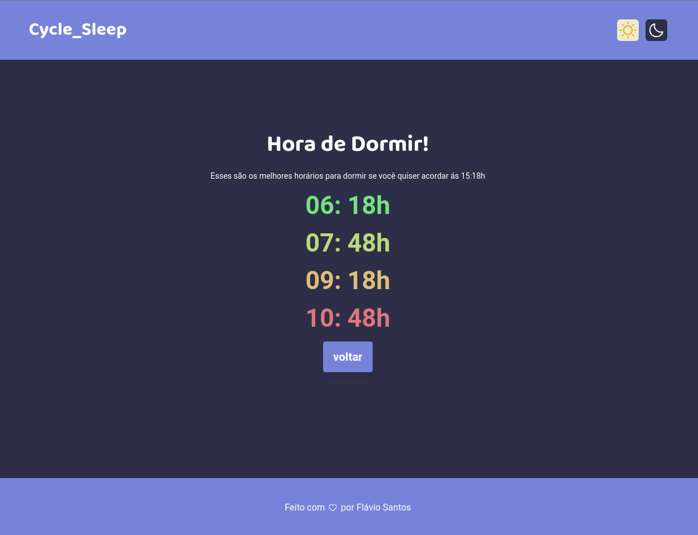

## xSleepCycle 🚀

- 🚀 xSleepCycle is an application that calculates the time you should go to bed or wake up according to the sleep's cycles you want to rest.

## 🛠️ Tech Stack

- **Frontend**: React.js, TypeScript, TailwindCSS, React-Testing-Library, Vitest.

## 👤 About Me

I’m a passionate developer with 6 years of experience. I value clean, maintainable code and building systems that solve real problems.

- [LinkedIn](https://www.linkedin.com/in/flvsantos15/)
- [GitHub](https://github.com/flvSantos15)
